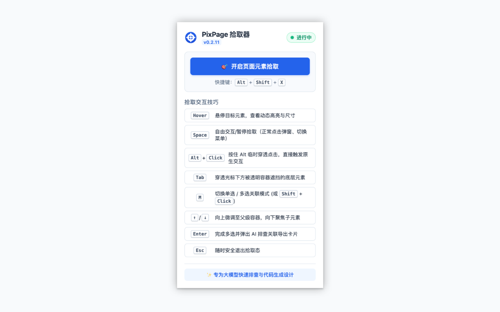
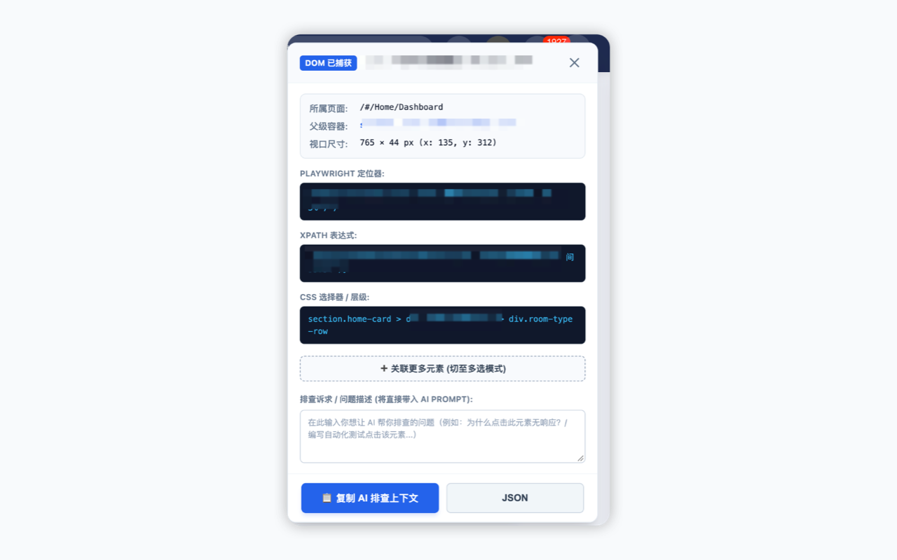
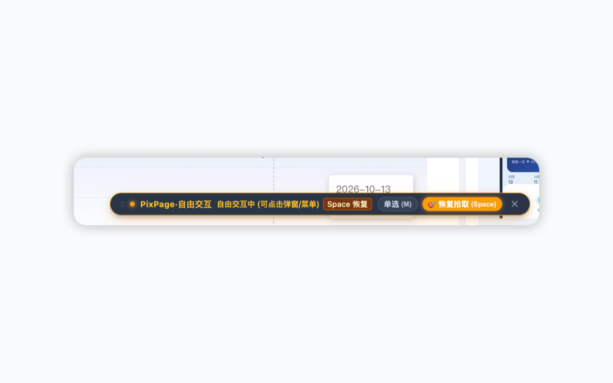

# PixPage 智能元素拾取助手 (Chrome Extension)

> **专为前端开发者、测试开发与 AI 协作打造的无侵入页面元素拾取与智能定位插件**  
> 一键点选提取高质量复合选择器（CSS / XPath / Playwright）、全量业务参数与几何坐标，生成 AI-Ready Markdown 提示词，秒级复制给大模型排查问题。

---

## 🌟 为什么需要它？

在日常开发、排查中后台 Bug（如 DPMS 房态系统）或编写自动化用例时，开发者常面临以下困境：
- **AI 截图盲猜不准**：把整页截图丢给大模型，微小按钮和二级状态卡片极易被漏检，像素坐标容易因窗口缩放和 Retina 屏幕点歪；
- **Chrome DevTools 复制链路长**：手动在 Elements 中 Copy Selector，拿到的是冗长脆弱的随机类名（如 `.el-table_1_column_2`），且缺少上下文参数；
- **人机协作输入断层**：需要反复手动打字告诉 AI“页面在哪里、这是什么按钮、类名是什么、祖先弹窗是什么”。

**PixPage 拾取助手** 就是为了解决上述痛点而生：
在目标页面按下快捷键，点击任意元素，立即获取最全的定位与参数数据，点击 **“复制 AI 排查上下文”** 即可直接贴给大模型！

---

## ✨ 核心特性

- 🎯 **高精度交互拾取**：鼠标悬停实时高亮，动态显示元素标签、尺寸与类名；
- 🛡️ **Shadow DOM 绝对隔离**：所有高亮框、气泡与弹窗均运行在私有 Shadow Root 中，**100% 免疫宿主页面的 CSS 污染，也绝不破坏被测页面任何排版**；
- ⚡ **自由交互与无害拦截**：默认在捕获阶段安全拦截，拾取时绝不触发原生业务；按 <kbd>Space</kbd> 空格键或悬浮栏按钮可随时挂起进入**自由交互模式**展开下拉菜单或弹窗表单，亦可按住 <kbd>Alt</kbd> 临时穿透点击；
- 🔄 **DOM 突变与 SPA 路由自适应**：基于 MutationObserver 与路由感知，单页应用菜单切换时自动隐藏/精准重算多选常驻高亮框，彻底杜绝跨菜单幽灵框；
- 🎹 **键盘层级穿透**：悬停时按键盘 **`↑`（向上移至父元素）** 或 **`↓`（向下移至子元素）**，按 **`Tab`（穿透底层遮罩）**，轻松拾取微小图标或遮挡元素；
- 🧭 **高鲁棒复合选择器**：优先级支持 `data-testid` > 稳定 ID > 语义文本 XPath > 属性定位器 > 过滤动态 Hash 的 CSS 链，同步输出现成的 `page.locator(...)` Playwright 语句；
- 🤖 **AI-Ready 即用输出**：内置精心排版的 Markdown 模版与标准 JSON，直击定位要素，直接贴入 Antigravity / Claude / ChatGPT 对话框。

---

## 📸 界面预览

| 扩展弹窗与快捷键引导 | DOM 捕获与 AI Prompt 面板 | 自由交互模式悬浮栏 |
| :---: | :---: | :---: |
|  |  |  |

---

## 🚀 快速安装指南 (Chrome 扩展开发者模式)

本扩展采用原生 **Manifest V3** 标准开发，无需使用 Webpack/Vite 编译打包，直接加载源码文件夹即可：

### 第一步：打开 Chrome 扩展程序管理页
在 Chrome 浏览器地址栏输入并回车：
```
chrome://extensions
```

### 第二步：开启“开发者模式”
在打开的页面右上角，将 **“开发者模式” (Developer mode)** 开关打开。

### 第三步：加载解压的扩展程序
1. 点击左上角的 **“加载已解压的扩展程序” (Load unpacked)** 按钮；
2. 在弹出的文件选择器中，选中本项目根目录：
   ```
   /Users/bou/Documents/mcp-study/pixpage-element-picking
   ```
3. 点击“选择”，扩展程序列表中即会出现 **“PixPage 智能元素拾取助手”**，并在浏览器工具栏右上角显示图标。

---

## 🎮 使用指南与快捷键

### 1. 开启拾取模式
打开你需要排查或测试的目标网页（例如 DPMS 房态系统前端），使用以下任一方式唤醒：
- **快捷键**：按下 <kbd>Alt</kbd> + <kbd>Shift</kbd> + <kbd>X</kbd>（Mac / Windows 通用）
- **图标点击**：点击 Chrome 浏览器右上角扩展图标，在弹窗中点击 **“开始拾取”**

页面底部出现 PixPage 工具栏，鼠标变为十字准星。

### 2. 拾取篮交互

不再区分单选/多选：点击一个就是一个，继续点击就是多个，所有元素按顺序进入右侧「拾取篮」。

| 按键 / 操作 | 功能描述 |
| :--- | :--- |
| **点击** | 加入拾取篮；再次点击已选元素则移除。页面原有点击、按下、拖拽等行为全部被拦截。 |
| **<kbd>⌘</kbd>/<kbd>Ctrl</kbd> + 点击** | 不加入拾取篮，直接复制该元素的 AI Prompt。 |
| **<kbd>Enter</kbd>** | 复制拾取篮内全部元素的 AI Prompt。 |
| **<kbd>Space</kbd>** | 暂停 / 继续拾取，暂停期间可正常打开弹窗、切换菜单、填写表单。 |
| **按住 <kbd>Alt</kbd>** | 临时放行，单次点击页面原生交互。 |
| **<kbd>Tab</kbd> / <kbd>Shift</kbd>+<kbd>Tab</kbd>（或 <kbd>]</kbd> <kbd>[</kbd>）** | 在光标下的叠层元素之间穿透。 |
| **<kbd>↑</kbd> / <kbd>↓</kbd>** | 选择父级容器 / 第一个子元素。 |
| **<kbd>Esc</kbd>** | 分级退出：拾取篮展开时先折叠为右侧窄条（继续拾取）；已折叠时再按一次退出整个工具并清空。 |

退出时，非空的拾取篮会自动存为「上次选择」（关闭标签页前一直有效，刷新页面也不丢）。下次开启时，工具栏和空拾取篮里会出现 **恢复上次** 入口，按需一键恢复；不点就从空拾取篮开始。

拾取篮可折叠为右侧窄条：窄条显示元素数量与编号，点击编号直接定位该元素，也可一键复制 Prompt；点击窄条顶部箭头、工具栏「拾取篮」按钮即可展开。拾取篮中的每个元素支持备注、上移/下移、定位与移除；被弹窗或遮罩挡住的已选元素以虚线框标出。底部可选择任务模板（排查交互问题 / 生成 Playwright 脚本 / 排查样式问题）并填写你的问题。

---

## 📋 复制给 AI 的效果示例

```markdown
# 页面元素上下文（由 PixPage 采集）

## 任务
请按元素顺序编写 Playwright (TypeScript) 测试脚本：优先使用标注为「唯一匹配」的定位器……

## 页面环境
- 页面: 「实时房态」 `http://localhost:8080/#/exclusive/dpms_room_status_realtime`

## 目标元素（共 1 个，按选取顺序）

### [1] <button> 「批量操作」
- 备注: 打开批量操作弹窗
- 位置: 容器 `div.room-status-toolbar`
- 状态: 可交互
- 推荐定位: `page.locator('[data-action="batch-modify"]')`
- 备选定位:
  - Test ID: `[data-action="batch-modify"]`（唯一匹配）
  - XPath: `//button[not(.//button) and contains(normalize-space(.), "批量操作")]`（唯一匹配）
- 祖先链: `div.main-layout > div.room-status-toolbar`
- 尺寸位置: 110×36px @ (1240, 52)，视口 1920×1080
- HTML 片段:
（html 代码块）
```

密码框、验证码、信用卡等敏感输入的值会被替换为 `[已脱敏]`，URL 中的 token / ticket 等参数会被移除。

---

## 📂 项目工程目录

```
pixpage-element-picking/
├── manifest.json              # Chrome MV3 核心清单文件
├── background.js              # Service Worker（启停、跨 Frame 中转、会话存储、错误日志、兜底注入）
├── icons/                     # 插件图标 (16/48/128 px 标准 PNG)
│   ├── icon-16.png
│   ├── icon-48.png
│   └── icon-128.png
├── popup/                     # 扩展弹窗视图
│   ├── popup.html             # 弹窗结构
│   ├── popup.css              # 弹窗样式
│   └── popup.js               # 弹窗控制逻辑
├── content/                   # 页面注入脚本套件
│   ├── runtime.js             # 分级日志 + 经 background 中转的跨 Frame 消息总线
│   ├── dom-utils.js           # 公共 DOM 工具（稳定标识、弹窗识别、遮挡检测、URL 脱敏）
│   ├── selector.js            # 智能选择器生成算法 (CSS / XPath / Playwright)
│   ├── extractor.js           # 元素数据采集（敏感值脱敏、HTML 片段、唯一性统计）
│   ├── prompt-builder.js      # 统一 Prompt / JSON 构建器与任务模板
│   ├── relink.js              # SPA DOM 重建后的元素重连与路由工具
│   ├── ui-styles.js           # Shadow DOM 设计令牌、组件样式与 SVG 图标
│   ├── ui-shadow.js           # 每个 Frame 的覆盖层（悬停框、选中框、Toast、剪贴板）
│   ├── session.js             # 拾取篮会话（顶层持有唯一状态）
│   ├── panel.js               # 顶层工具栏与拾取篮侧边面板
│   ├── inspector.js           # 每个 Frame 的拾取引擎（事件拦截、层级导航、定位）
│   └── content.js             # 入口脚本（消息接入、孤儿实例清理）
├── docs/                      # 核心项目文档
│   ├── CHANGELOG.md              # 全量版本演进与变更历史明细 (ChangeLog)
│   ├── PRIVACY.md                # Chrome Web Store 上架合规中英文隐私政策
│   ├── technical_architecture.md # 技术架构设计全景文档
│   └── mvp_and_iterations.md     # MVP 边界与版本迭代路线图
├── package.sh                 # Chrome 扩展纯净生产包自动打包脚本
├── CHROMEWEBSTORE.md          # 谷歌应用商店上架申报文案与权限理由全景表
├── .gitignore                 # Git 忽略规则配置
├── AGENTS.md                  # AI Agent 协作行为守则与架构契约
└── README.md                  # 用户使用与安装指南
```

---

## 🧭 后续演进路线

- **v0.2.0 (第二期)**：迁移到 Chrome 原生 **Side Panel**，支持多元素批量暂存池、点击侧边栏反向在页面高亮定位、局部 Canvas 小图裁剪；
- **v0.3.0 (第三期)**：接入全页智能顺序扫描算法，一键提取整页可点击控件，直连自动化测试平台（`localhost:5005`）API，自动落库 `meta.yaml`。

---

## 📄 规范与协议

- 架构准则与协同规范详见 [`AGENTS.md`](./AGENTS.md)；
- 完整版本演进历史记录详见 [`docs/CHANGELOG.md`](./docs/CHANGELOG.md)。任何涉及架构变更与重要功能修改，均需严格登记于变动历史记录中。
