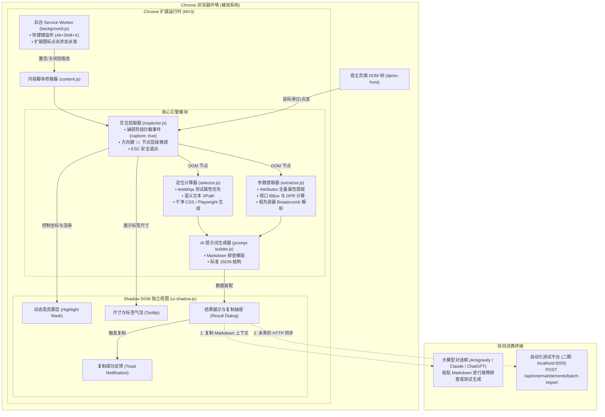

# Chrome 元素智能采集插件技术架构设计方案

## 一、 项目背景与设计目标

### 1.1 背景痛点
在复杂企业级 Web 系统（如 DPMS 房态中后台系统）的日常排错、用例编写与自动化测试中，传统方式存在显著痛点：
1. **大模型截图识别脆弱**：单纯依赖全屏截图交由视觉大模型（如 Qwen-VL）猜测元素位置，极易在密集按钮、表格卡片、二级菜单等微小组件上发生漏检或定位偏移。
2. **人工定位排查低效**：开发者在 Chrome DevTools 的 Elements 面板中反复右键“Copy Selector”，得到的通常是脆弱的随机打包类名或冗长路径，且缺乏完整的参数与容器上下文。
3. **AI 协同输入断层**：需要将页面地址、元素参数、祖先容器、选择器手动敲入 AI 输入框，人机协作步骤繁琐、易遗漏关键属性。

### 1.2 核心设计目标
构建一款专用的 **Chrome 元素智能采集扩展（Manifest V3）**，第一期（MVP）聚焦于轻量无侵入的交互式拾取与 AI 提示词标准化转换，后续平滑过渡为自动化测试平台知识库录入工具：
- **零样式污染（Zero Contamination）**：采用 Web Component / Shadow DOM 隔离所有插件 UI，绝不破坏宿主系统的 CSS 和布局；
- **全要素采集（Rich Context Gathering）**：一次点击同步提取多重高可靠定位器、完整 DOM 属性、几何坐标（BBox + DPR）、页面路由及外层容器；
- **AI-Ready 即用交付**：提供一键复制为格式化 Markdown 的能力，内容直击核心定位要素，直接贴入大模型输入框即可高效排查问题与生成代码。

---

## 二、 系统架构图与数据流



---

## 三、 核心模块技术设计

### 3.1 零侵入 Shadow DOM 隔离架构
企业级 Web 框架往往覆盖了大量的全局标签选择器（如 `div { box-sizing: border-box; }`、`button { all: unset; }`）。
为保证绝对稳定性，插件在页面创建唯一的 Host 容器并挂载 Shadow Root：
```javascript
const host = document.createElement('pixpage-inspector-host');
const shadowRoot = host.attachShadow({ mode: 'open' });
```
所有插件私有样式（高亮蓝框、提示面板、按钮、代码高亮区域）均内联在 `shadowRoot` 内部的 `<style>` 标签中，实现**双向免疫**：
- 插件样式绝不溢出到宿主页面；
- 宿主页面的 CSS 样式绝不污染插件交互卡片。

### 3.2 捕获阶段事件拦截机制
为防止拾取点击时触发页面本身的业务跳转或表单提交，监听器必须配置为捕获阶段生效，并在处理完后立即阻断事件冒泡与默认动作：
```javascript
function onClick(event) {
  if (!isPickingMode) return;
  // 阻止触发页面原有逻辑
  event.preventDefault();
  event.stopPropagation();
  event.stopImmediatePropagation();

  const target = event.target;
  // 提取元素特征与展示结果
  handleElementPicked(target);
}
window.addEventListener('click', onClick, { capture: true, passive: false });
```

### 3.3 复合定位器计算引擎 (Selector Engine)
按照稳定性从高到低的优先级链式计算：
1. **测试专用属性**：`data-testid` > `data-qa` > `data-action` > `data-cy`
2. **稳定语义 ID**：非随机自增和非 Hash 格式的唯一 ID（`#btn-save`）
3. **语义文本 XPath**：截取 25 字以内的稳定文案生成精简 XPath：
   - `xpath=//button[contains(., '批量操作')]`
   - 并同步输出 Playwright 语法：`page.locator("button:has-text('批量操作')")`
4. **属性定位器**：输入框提取 `placeholder` / `name`，如 `input[placeholder='请输入房间号']`
5. **结构化 CSS 选择器**：提取元素本身的语义 Class（自动剥离 `v-xxx`、动态 Hash 类名），并结合父级回溯 2~3 层形成稳定链。

### 3.4 元素丰富特征提取器 (Context Extractor)
为了帮助大模型深入理解组件在系统中的角色，提取器不仅抽取该元素本身，还采集丰富的周边环境：
- **属性集 (Attributes)**：提取 `id`, `name`, `type`, `value`, `placeholder`, `disabled`, `readonly`, `aria-*`, `role` 等；
- **几何与视口参数**：`BoundingClientRect` (x, y, width, height)，结合 `window.devicePixelRatio` 提供真实像素坐标；
- **祖先层级链路 (Breadcrumb)**：构建向上的父级路径链（如 `div.app-container > div.room-toolbar > button.ivu-btn`）；
- **所属弹窗或特殊容器判定**：自动向上探测最近的 `.dialog`, `.modal`, `.drawer`, `.popup` 或 `[role="dialog"]` 容器，标识其处于弹窗内部还是主视图中。

---

## 四、 安全性与性能保障

1. **内存泄漏防护**：
   - 退出拾取态时，一键注销全局 `mousemove`、`click`、`keydown` 事件监听；
   - 彻底移除高亮遮罩与 Tooltip，仅保留或按需展示结果面板；
2. **执行性能优化**：
   - 鼠标滑动（`mousemove`）采用 `requestAnimationFrame` 节流更新高亮框坐标，保证 60fps 丝滑跟随；
3. **数据敏感合规**：
   - 第一期所有提取与格式化全部在前端本地运行，不向任何第三方服务器上传隐私数据或 Cookie。
